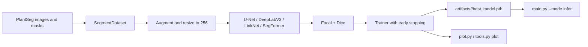

# Lesioni

Lesioni segments diseased regions on plant leaves. I trained four architectures on PlantSeg v3 behind one `--model_type` flag: U-Net with a ResNet-34 encoder, DeepLabV3 with a MobileNetV3-Large backbone, LinkNet with a MobileNetV2 encoder, and a U-Net with a MiT-B0 encoder. The loss is focal plus Dice because background is 80.21% of the training pixels. Each run keeps its resolved hyperparameters, architecture summary, per-epoch Dice and IoU, checkpoints, and early-stopping state. DeepLabV3 was the only architecture that stayed above 35% validation Dice; LinkNet did not learn under this schedule.


_Validation Dice on PlantSeg v3 (1,247 images, 256 px). The curves are the latest completed run per `--model_type` selected by `plot.py`. LinkNet stays at 0% for the whole run._

## Contents

- [Results](#results)
- [Dataset](#dataset)
- [Requirements](#requirements)
- [Reproduce](#reproduce)
- [How it works](#how-it-works)
- [Configuration](#configuration)
- [Project layout](#project-layout)
- [Related projects](#related-projects)
- [Stack](#stack)

## Results

The table is the latest completed run for each architecture, which is what `plot.py` selects. Dice and IoU exclude the background class.

| Model type | Architecture | Best validation Dice | Best validation IoU | Best epoch | Epochs run | Run directory |
| --- | --- | ---: | ---: | ---: | ---: | --- |
| `unet` | U-Net, ResNet-34 encoder | 19.88% | 9.41% | 49 | 50 | `20260629_171430_unet_116class` |
| `deeplabv3` | DeepLabV3, MobileNetV3-Large | 37.63% | 23.08% | 45 | 55 | `20260629_143853_deeplabv3_116class` |
| `linknet` | LinkNet, MobileNetV2 encoder | 0.00% | 0.00% | 1 | 11 | `20260629_192259_linknet_116class` |
| `segformer` | U-Net, MiT-B0 encoder | 24.19% | 12.23% | 72 | 82 | `20260629_202510_segformer_116class` |

The protocol is the PlantSeg v3 validation split (1,247 images) at 256 px with 116 classes. All runs use batch size 32, `ReduceLROnPlateau`, patience 10, and early stopping. The numbers come from `artifacts/<run>/model_history.json` in my workspace; the `artifacts/` directory is gitignored. The committed figures are generated from those files.

DeepLabV3 is the best run, and it also shows the clearest overfitting. In `02_best_run_diagnostics.png`, training Dice reaches about 61.5% while validation Dice stays near 37%, a gap of roughly 24 points. The best validation epoch is 45, and the run stops at 55 after patience expires.

LinkNet's row is not a rounding error. It stayed at 0.00% Dice and 0.00% IoU for 11 epochs and stopped. I left it in the table because it is the result of the same training recipe.

The test split (2,295 images) is not evaluated. Every number here is validation.

## Dataset

PlantSeg v3 is the "A Large-Scale In-the-wild Dataset for Plant Disease Segmentation" dataset:

- 7,916 training images, 1,247 validation images, and 2,295 test images.
- 116 label indices including background. `class_mapping.json` lists 115 disease names.
- 80.21% background and 19.79% foreground across the 7,916 training masks, measured by `eda.py`.
- 1.06 GB compressed, about 1.8 GB extracted.
- License: CC BY-NC 4.0, so non-commercial use only.

Source: [Zenodo record 17719108](https://zenodo.org/records/17719108), DOI `10.5281/zenodo.17719108`.

Download and extract it:

```bash
python tools.py --mode download --root_dir dataset
```

The archive extracts to `dataset/plantseg/`:

```text
dataset/plantseg/
├── images/
│   ├── train/
│   ├── val/
│   └── test/
└── annotations/
    ├── train/
    ├── val/
    └── test/
```

`SegmentDataset` pairs an image with the mask that has the same stem, so `images/train/leaf_001.jpg` needs `annotations/train/leaf_001.png`.

Verify the download:

```bash
python tools.py --mode verify --root_dir dataset
```

The verifier checks that the train and validation split folders exist and compares the first 20 image stems per split against the mask filenames. It does not check all 9,000+ pairs, and it does not open the images.

Print the pixel distribution:

```bash
python eda.py
```

## Requirements

- Python 3.10 or newer.
- PyTorch 2.0 or newer, torchvision 0.15 or newer, and torchmetrics 1.0 or newer. The code uses `torchvision.transforms.v2` and `torchmetrics.segmentation`.
- `segmentation_models_pytorch` for the U-Net, LinkNet, and MiT-B0 encoder.
- A CUDA GPU for training. CPU inference works and is what the inference script uses when CUDA is unavailable.
- About 1.8 GB of disk for the extracted dataset.
- The run histories do not record which GPU was used.

```bash
git clone https://github.com/abderrahmenex86/Lesioni
cd Lesioni
python -m venv .venv
source .venv/bin/activate
pip install -r requirements.txt
```

## Reproduce

### Weights

The repository does not ship weights. Each run writes:

| File | What it contains |
| --- | --- |
| `best_model.pth` | State dict with the best validation Dice |
| `checkpoint.pth` | State dict, optimizer, scheduler, best Dice, and history |
| `hyperparameters.json` | Resolved arguments |
| `architecture.txt` | `torchinfo` summary |
| `model_history.json` | Per-epoch train and validation loss, Dice, and IoU |

`src/infer.py` loads `hyperparameters.json` and `best_model.pth`. If `best_model.pth` is missing, it falls back to the `checkpoint.pth` state dict.

### Sanity check

```bash
python main.py --mode test \
  --model_type unet \
  --root_dir dataset/plantseg \
  --num_classes 116 \
  --img_size 256
```

The check loads 5 samples with batch size 2 and verifies the image and mask shapes, normalization bounds, forward pass, backward pass, gradient validity, and optimizer group construction. The final line is:

```text
SANITY CHECKS COMPLETED. PIPELINE VERIFIED.
```

### Train

This command matches the DeepLabV3 run in the results table:

```bash
python main.py --mode train \
  --model_type deeplabv3 \
  --root_dir dataset/plantseg \
  --num_classes 116 \
  --img_size 256 \
  --batch_size 32 \
  --epochs 100 \
  --patience 10 \
  --optimizer_type Adam \
  --learning_rate 0.001 \
  --weight_decay 0.000004
```

The trainer creates `artifacts/<timestamp>_deeplabv3_116class/` and writes `hyperparameters.json` before the first epoch. The loop prints one line per epoch. These are the first-epoch values from the DeepLabV3 run in the results table:

```text
[Epoch 01] Train Loss: 2.1859 | Dice: 1.37% | IoU: 0.61% | Val Loss: 2.2243 | Dice: 2.62% | IoU: 1.29%
```

A new best validation Dice writes `best_model.pth`. `checkpoint.pth` is overwritten every epoch. Early stopping ends the run when validation Dice does not improve for `patience` epochs.

Resume from the latest run:

```bash
python main.py --mode train --resume --model_type deeplabv3 --root_dir dataset/plantseg
```

`--resume` scans `artifacts/` and uses the last run's `checkpoint.pth`.

### Optimize

```bash
python main.py --mode optimize --model_type unet --root_dir dataset/plantseg
```

The study runs 30 trials with 10 epochs per trial on the first 512 training and validation images. It searches `learning_rate` in `[1e-5, 1e-2]` on a log scale, `weight_decay` in `[1e-6, 1e-3]` on a log scale, and `optimizer_type` in `{AdamW, Adam, SGD}`. For U-Net it also suggests `base_channels` in `{32, 64}`, but the model builder does not pass that value to `smp.Unet`; treat it as a no-op. The study writes `optuna_summary.json` and prints the best training command.

### Evaluate

There is no standalone test-set evaluation. The training loop writes validation metrics to `model_history.json` every epoch. Two plotting paths read those files:

```bash
python tools.py --mode plot
```

This takes the latest run under `artifacts/` and writes `docs/figs/training_metrics_grid.png` with loss, Dice, IoU, and the validation-minus-training loss gap.

```bash
python plot.py
```

This builds the six comparison figures in `docs/figs/`: model comparison by Dice and IoU, best-run diagnostics, Optuna convergence, the generalization gap, and the Optuna search landscape. It selects the latest completed run per model type and builds each figure when the corresponding run history or Optuna summary exists. It overwrites the committed figures, so run it only when you want to replace them.

Single-image inference:

```bash
python main.py --mode infer \
  --model_type deeplabv3 \
  --root_dir dataset/plantseg \
  --run_dir artifacts/<run> \
  --image_path path/to/leaf.jpg
```

Replace `<run>` with a directory produced by training. The script loads the run's `hyperparameters.json` and weights, predicts a mask, prints the active class indices, and writes an overlay to `docs/figs/inference_output_<image-name>`. The overlay uses red masks with alpha 0.6; if no disease class is predicted, it writes the unmodified image.

## How it works

1. `SegmentDataset` pairs each image with its mask by stem. Masks are loaded as 8-bit grayscale. For `num_classes == 1` the mask becomes a float binary mask; otherwise it stays an integer class map.
2. Training transforms resize to `img_size` (256 by default), then apply horizontal and vertical flips, rotation up to 25 degrees, affine translation and scale, perspective distortion, color jitter, and Gaussian blur. Validation resizes and normalizes only. Both use ImageNet mean and standard deviation.
3. `build_model` maps `unet` to `smp.Unet` with a ResNet-34 encoder, `deeplabv3` to torchvision's `deeplabv3_mobilenet_v3_large`, `linknet` to `smp.Linknet` with a MobileNetV2 encoder, and `segformer` to `smp.Unet` with a MiT-B0 encoder. The `segformer` key is a U-Net decoder with a SegFormer encoder, not the original SegFormer head.
4. The loss is `FocalDiceLoss`: a focal term plus a Dice term. The multiclass branch uses gamma 2.0 and no per-class weights; the binary branch also uses alpha 0.25. There is no class weighting beyond the Dice overlap.
5. `build_optimizer` splits parameters into an encoder group at `0.1 * learning_rate` and a decoder/head group at `learning_rate`. The scheduler is `ReduceLROnPlateau(mode="max", factor=0.5, patience=patience // 2)`, stepped on validation Dice.
6. `Trainer` computes macro Dice and mean IoU with `torchmetrics`, excluding background by default. It clips gradients at 1.0, writes `model_history.json` every epoch, saves `best_model.pth` on a new best validation Dice, and writes `checkpoint.pth` every epoch.
7. Inference rebuilds the pipeline from `hyperparameters.json`, loads the best checkpoint, applies the validation transform, and overlays the predicted disease classes. Plotting reads `model_history.json` and `optuna_summary.json` from `artifacts/`.



## Configuration

Command-line arguments:

| Flag | Default | What it does |
| --- | --- | --- |
| `--mode` | required | `test`, `train`, `optimize`, or `infer` |
| `--model_type` | `unet` | `unet`, `deeplabv3`, `linknet`, or `segformer` |
| `--root_dir` | `dataset/plantseg` | Dataset root |
| `--run_dir` | generated for train and optimize; `artifacts/default` for test and infer | Output or inference run directory |
| `--resume` | false | Resume from the latest `checkpoint.pth` |
| `--image_path` | none | Inference image |

Dynamic arguments, parsed as `--key value`:

| Argument | Default | What it does |
| --- | --- | --- |
| `--num_classes` | 116 | Label count including background |
| `--img_size` | 256 | Resize size |
| `--batch_size` | 32 | Loader batch size |
| `--epochs` | 100 | Training epochs |
| `--patience` | 10 | Early-stopping patience |
| `--optimizer_type` | `AdamW` | Any `torch.optim` class name |
| `--learning_rate` | `1e-3` | Base learning rate; encoder gets 0.1x |
| `--weight_decay` | `1e-4` | Optimizer weight decay |
| `--scheduler_type` | `ReduceLROnPlateau` | Any `torch.optim.lr_scheduler` class name |
| `--encoder_name` | `resnet34` | U-Net encoder |
| `--encoder_weights` | `imagenet` | U-Net encoder weights |
| `--optuna_trials` | 30 | Optimization trials |
| `--optuna_epochs` | 10 | Epochs per trial |
| `--limit_dataset` | none | Cap the number of files per split |
| `--aug_rotation` | 25 | Rotation degrees |
| `--aug_translation` | 0.1 | Affine translation limit |
| `--aug_scale` | 0.1 | Affine scale limit |
| `--aug_perspective` | 0.2 | Perspective distortion scale |
| `--aug_hflip_p` | 0.5 | Horizontal flip probability |
| `--aug_vflip_p` | 0.5 | Vertical flip probability |
| `--aug_brightness` | 0.2 | Color jitter brightness |
| `--aug_contrast` | 0.2 | Color jitter contrast |
| `--aug_saturation` | 0.2 | Color jitter saturation |
| `--aug_blur_p` | 0.3 | Gaussian blur probability |

Artifacts:

| File | What it contains |
| --- | --- |
| `hyperparameters.json` | Resolved arguments |
| `architecture.txt` | `torchinfo` summary |
| `model_history.json` | Per-epoch loss, Dice, and IoU |
| `best_model.pth` | Best validation Dice state dict |
| `checkpoint.pth` | State dict, optimizer, scheduler, best Dice, history |
| `optuna_summary.json` | Best trial and all trial values, in optimize runs |

## Project layout

| Path | What it is |
| --- | --- |
| `main.py` | CLI dispatcher for test, train, optimize, and infer |
| `src/dataset.py` | `SegmentDataset`, transforms, and loaders |
| `src/models.py` | U-Net, DeepLabV3, LinkNet, SegFormer, `FocalDiceLoss` |
| `src/factory.py` | Model, optimizer, scheduler, and loss builders |
| `src/trainer.py` | `Trainer`, Dice/IoU metrics, checkpoints, early stopping |
| `src/tester.py` | Five-sample shape, forward, backward, and gradient checks |
| `src/optimize.py` | Optuna study on a 512-image subset |
| `src/infer.py` | Single-image mask overlay |
| `src/helpers.py` | Download, verify, and single-run plotting helpers |
| `tools.py` | `download`, `verify`, and `plot` CLI |
| `plot.py` | Six comparison and diagnostic figures |
| `eda.py` | Background and class pixel distribution |
| `class_mapping.json` | 115 disease names |
| `requirements.txt` | Python dependencies |
| `metadata.tar` | An archive of my earlier `artifacts/` tree; not used by the code |

## Related projects

- [Flora](https://github.com/abderrahmenex86/Flora) for plant species classification
- [Entomi](https://github.com/abderrahmenex86/Entomi) for insect and pest classification

## Stack

| Component | Version / floor | Notes |
| --- | --- | --- |
| Python | 3.10+ | Floor from the project statement |
| PyTorch | 2.0+ | `torchvision.transforms.v2` and `torchmetrics.segmentation` set the floor |
| torchvision | 0.15+ | Same floor as PyTorch 2.0 |
| torchmetrics | 1.0+ | Segmentation Dice and IoU |
| segmentation_models_pytorch | not pinned | U-Net, LinkNet, and MiT-B0 encoder |
| Optuna | not pinned | Hyperparameter search |
| torchinfo | not pinned | Architecture summary |
| matplotlib | not pinned | Figures |
| numpy | not pinned | Mask statistics |
| Pillow | not pinned | Image and mask loading |
| tqdm | not pinned | Progress bars |
